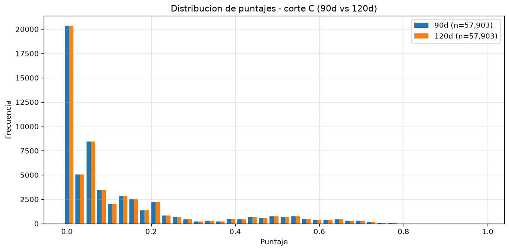
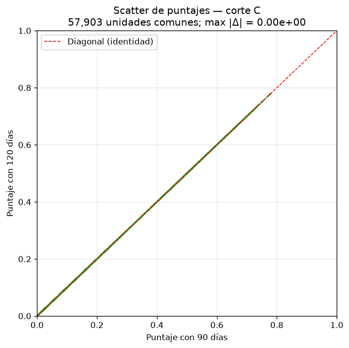

# Fase 2.4 — Prueba de invariancia temporal

**Corte evaluado:** `2026-08-30 00:00:00`

**Definición operativa:** el mismo modelo (`p2_hgb_v1.0.0.pkl`) y el mismo `predecir.py` se aplican sobre dos datasets:

- **90 días** (datos originales del proyecto, hasta el 29-ago).
- **120 días** (datos con 30 días adicionales, hasta el 28-sep).

Para el corte C, ambos deben producir **el mismo CSV**. Si difieren, hay fuga de datos futuros.

## 0. Veredicto por componente

| Componente | Resultado |
|---|---|
| determinismo | ✅ |
| no_reentrena | ✅ |
| poblacion_identica | ✅ |
| puntajes_identicos | ✅ |
| contactar_identicos | ✅ |
| tarjetas_identicas | ✅ |
| csv_identico | ✅ |

**Veredicto global:** ✅ PASA

## 1. Determinismo (mismos datos, dos corridas)

- Hash corrida 1: `4b217e9ec8554342...`
- Hash corrida 2: `4b217e9ec8554342...`
- **¿Idénticos bit a bit?** ✅ Sí

## 2. No-reentrenamiento del modelo

- Hash del `.pkl` antes:  `7abc25585a2351c8...`
- Hash del `.pkl` después: `7abc25585a2351c8...`
- **¿El modelo cambió?** ✅ No (solo carga)

## 3. Invariancia temporal (90d vs 120d)

| Métrica | Valor |
|---|---|
| Usuarios en 90d | 57,903 |
| Usuarios en 120d | 57,903 |
| Usuarios en común | 57,903 |
| Solo en 90d | 0 |
| Solo en 120d | 0 |
| Max |Δ puntaje| | 0.00e+00 |
| Media |Δ puntaje| | 0.00e+00 |
| Contactar distintos | 0 |
| Tarjetas distintas | 0 |
| Unidades en el diff | 0 |
| **¿CSV idéntico bit a bit?** | ✅ Sí |

## 4. Gráficas

### Histograma superpuesto

### Scatter 90d vs 120d (debe ser la diagonal)

## 5. Conclusión

**La prueba de invariancia pasa.** El mismo `predecir.py` y el mismo modelo, aplicados sobre 90 y 120 días, producen **exactamente el mismo CSV** para el corte C. El pipeline filtra `ts < fecha_corte` antes de calcular features, población y tarjetas, y no reentrena. **No hay fuga de datos futuros.**

**Evidencia:**
- Hash del CSV 90d:  `4b217e9ec8554342...`
- Hash del CSV 120d: `4b217e9ec8554342...`
