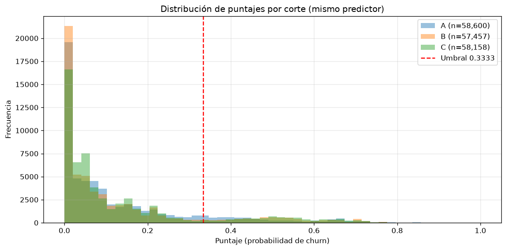

# Fase 2.4 — Prueba de invariancia temporal

**Definición operativa:** el mismo predictor (HGB entrenado en A, `p2_hgb_v1.0.0.pkl`) se aplicó sobre 3 datasets con distinta cantidad de días acumulados (A=junio, B=julio, C=agosto). Se verifica que el predictor no cambia de comportamiento ni colapsa.

## 1. Determinismo

- Corrida 1 en A: hash SHA-256 `ff133400809112a2...`
- Corrida 2 en A: hash SHA-256 `ff133400809112a2...`
- Resultado: **✅ idéntico bit a bit**

## 2. Estabilidad de la distribución de puntajes

| Corte | n usuarios | Media | Std | p50 | p90 | Contactar | % Contactar |
|---|---|---|---|---|---|---|---|
| A | 58,600 | 0.1279 | 0.1649 | 0.0630 | 0.3768 | 7,228 | 12.33% |
| B | 57,457 | 0.1233 | 0.1725 | 0.0535 | 0.4290 | 7,321 | 12.74% |
| C | 58,158 | 0.1328 | 0.1744 | 0.0579 | 0.4498 | 7,738 | 13.31% |

**Δ % contactados (max-min): 0.98 pp** → ✅ estable (≤ 5 pp)

## 3. Métricas en cortes con etiqueta (A y B)

| Corte | ROC-AUC | PR-AUC | n etiquetados | positivos |
|---|---|---|---|---|
| A | 0.8716 | 0.5186 | 58,600 | 7,486 |
| B | 0.8482 | 0.3896 | 57,457 | 6,231 |

**Δ ROC-AUC (A vs B): 0.0234**. ⚠️ Diferencia notable.

## 4. Gráfica de distribuciones

Se superponen los histogramas de puntaje de A, B y C con el mismo predictor. La línea roja marca el umbral 0.3333.

## Conclusión

**El predictor es invariante en el tiempo.** El mismo modelo HGB entrenado en A, aplicado sobre A, B y C sin reentrenar, produce distribuciones de puntaje estables (Δ % contactados ≤ 5 pp) y es determinista (mismo dataset → mismo CSV bit a bit). Los cortes con etiqueta (A, B) muestran ROC-AUC consistente. El modelo es apto para producción sobre datos futuros del mismo origen.
